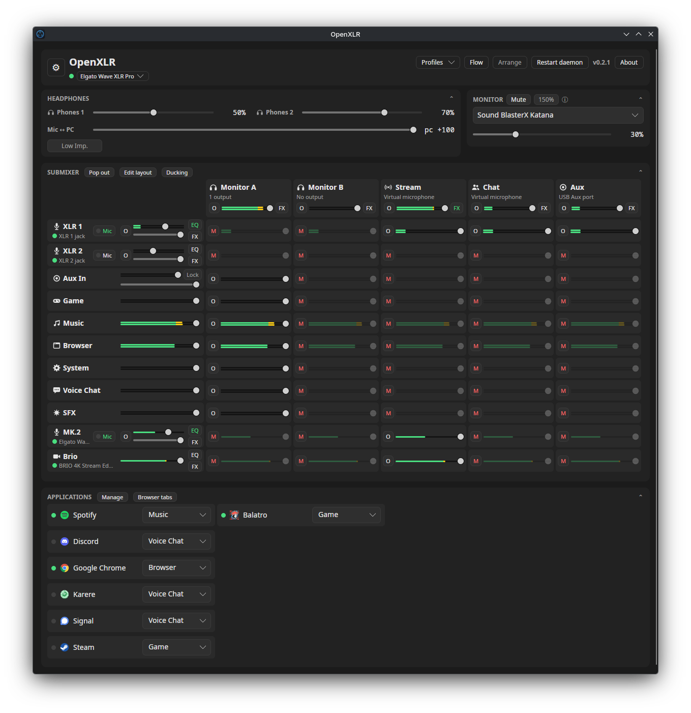

[](https://github.com/emaspa/openxlr/releases)
[](https://aur.archlinux.org/packages/openxlr)
[](https://copr.fedorainfracloud.org/coprs/emaspa/openxlr/)
[](https://launchpad.net/~sparvoli/+archive/ubuntu/openxlr)
[](https://github.com/emaspa/openxlr/releases/latest)
[](packaging/yabridge/README.md)

[](https://discord.gg/4bswtnGPW4)
[](https://www.reddit.com/r/OpenXLR/)
[](https://buymeacoffee.com/emaspa)
[](https://ko-fi.com/emaspa)
[](https://github.com/sponsors/emaspa)

OpenXLR is a Wave Link replacement for Linux, and it works with any
microphone or audio interface PipeWire can record from. Its mixer runs on
PipeWire: per-application channels, virtual microphones for calls and
streams, monitor mixes on any output, ducking, a microphone EQ, LV2, CLAP
and VST3 plugin inserts, and an OpenDeck plugin for Stream Deck control.

On Elgato hardware OpenXLR also controls the device itself, over
reverse-engineered USB protocols: gain, mute, phantom power, the onboard
effects and EQ, the headphone outputs and, on the Wave XLR Pro, the output
routing, a mix for a second computer on the USB Aux port and ducking on
the unit's own processor.




The UI from 0.2.1 and the terminal mixer from 0.2.0, both in the Broadcast
skin. This README and the linked guides describe current `main`; for a
released build, read the docs at its release tag.

Not affiliated with or endorsed by Elgato. The device protocols were
decoded from Wave Link USB captures, prior open-source protocol work and
tests on the author's own hardware.

## Supported devices

Any microphone, headset, webcam or audio interface that PipeWire lists as
a capture source works in the mixer. Bound to XLR 1 or XLR 2
([manual](docs/manual.md#input-bindings)) it gets that strip's sends,
volume, meter, EQ, insert chain and Sound Check. OpenXLR sends nothing to
another brand's device, so set its preamp gain and phantom power on the
device itself.

These Elgato devices also get their hardware controls over USB:

| Device | USB id | Status |
|---|---|---|
| Wave XLR Pro | 0fd9:00b4 | controls and the EQ on the unit verified on hardware; ducking on the unit accepted by ear on the headphone jacks |
| XLR Dock (Stream Deck+ module) | 0fd9:00a6 | gain, mute, headphone volume, 48V phantom power, low impedance; verified |
| Wave XLR | 0fd9:007d | gain, mute, headphone volume and low impedance verified by community testers; phantom power awaits a check |
| Wave XLR MK.2 | 0fd9:00b6 | gain, mute, phantom power, DSP, ClipGuard, compressor, headphone volume, crossfade; verified by a community tester |
| XLR Dock MK.2 (Stream Deck+ module) | 0fd9:00c7 | the Wave XLR MK.2's controls, verified |
| Wave:3 | 0fd9:0070 | gain, mute, ClipGuard, headphone volume and the monitor balance, each written and read back on the maintainer's unit |
| Wave:1 | 0fd9:006e | the Wave:3's controls; gain, mute and headphone volume confirmed by an owner |

The per-control state of every device, including what is coded but not
yet run on hardware, is in [hardware support](docs/hardware-support.md).
If you own an untested device, open an issue with a diagnostics archive
(Options, SUPPORT, Collect diagnostics).

## Features

- **Hardware control** of the devices above. The Pro has the most:
  gain, mute, low cut, expander, Voice Tune and phantom power per input,
  ClipGuard, compressor, two headphone volumes, the mic/PC crossfade and
  the routing of HP1, HP2, Line Out and USB Aux. Where a device has no
  hardware low cut or ClipGuard, OpenXLR runs them in software.
- **Submixer** built from PipeWire nodes, no kernel modules: channels for
  the XLR inputs, Aux In, application groups and any other capture
  source; monitor mixes on any outputs, alone or summed; virtual
  microphones other apps record from. Channels and mixes are added,
  renamed, reordered and removed while audio plays.
- **Ducking**: a key microphone lowers chosen channels in chosen mixes
  while you speak. It runs in software on every device, and on the Pro's
  own processor when the setup fits what the unit can do.
- **Microphone processing**: a four-band EQ with Wave Link's band types
  and steps on XLR 1, XLR 2 and mono capture inputs, run on the unit
  where the hardware has one, and Sound Check, which loops a recorded take
  through the EQ and plugins while you tune them.
- **Plugin inserts**: LV2, CLAP and VST3 chains on each microphone input
  and each mix, with native editors, generated controls and bypass.
  Windows VST3 and CLAP plugins run through the `openxlr-yabridge`
  package.
- **Application routing**: apps are matched to channels by name rules and
  remembered, Electron and Wine/Proton apps included. An optional
  Chromium companion routes individual browser tabs
  ([browser routing](docs/browser-routing.md)).
- **Profiles**: named scenes of hardware settings and the whole submix,
  recalled from the UI, the API or a Stream Deck key, or on connect.
- **OpenDeck plugin**: keys and dials for every switch, mute, level,
  insert, output and profile, drawn with meters and status lamps.
- **Daemon, UI and APIs**: the daemon owns the device and the graph and
  keeps running with the UI closed. It serves a WebSocket API and an HTTP
  API on 127.0.0.1:37890. The UI has a Flow window of signal paths, a
  tray icon and global shortcuts through the desktop portal.
- **Terminal mixer**: `openxlr-tui`, the whole mixer over ssh or in a
  tiling setup ([manual](docs/manual.md#terminal)).
- **Omarchy bar**: meters, mutes and sends in Omarchy 4's bar
  ([omarchy.md](docs/omarchy.md)).
- **Skins**: sixteen built in, among them Broadcast (the default) and
  Wave, which draw the mixer as a matrix of inputs and mixes. A skin is
  data, not code ([skins.md](docs/skins.md)).
- **Languages**: English, German, Spanish, Italian, Tagalog, Cebuano and
  Serbian (Cyrillic) ([localization](docs/localization.md)).

Every control, area by area: [docs/features.md](docs/features.md).

### OpenDeck plugin

Dials get a touch panel with a knob, a level meter, the value and a mute
overlay; one dial can hold several targets.


Keys show an icon and a status lamp: red for a mute, green for an engaged
feature or the active monitor output.


## Install

Packages exist for Arch Linux, CachyOS and Omarchy (AUR), Ubuntu (PPA),
Fedora (COPR) and NixOS (flake). Every release also carries a `.deb` and
an `.rpm`, with SHA-256 checksums and a build provenance attestation
(`gh attestation verify <file> --owner emaspa`).

**Arch Linux, CachyOS and Omarchy**, from the
[AUR](https://aur.archlinux.org/packages/openxlr):

```sh
yay -S openxlr        # or: paru -S openxlr
systemctl --user enable --now openxlr-daemon
openxlr               # the mixer UI, also in your application menu
```

On Omarchy, run `openxlr-omarchy-enable` once for the bar plugin.

**Ubuntu** 24.04 and 26.04, from the
[PPA](https://launchpad.net/~sparvoli/+archive/ubuntu/openxlr):

```sh
sudo add-apt-repository ppa:sparvoli/openxlr
sudo apt install openxlr
systemctl --user enable --now openxlr-daemon
openxlr
```

**Fedora** 44 or newer, from
[COPR](https://copr.fedorainfracloud.org/coprs/emaspa/openxlr/):

```sh
sudo dnf copr enable emaspa/openxlr
sudo dnf install openxlr
systemctl --user enable --now openxlr-daemon
openxlr
```

Without the PPA or COPR, install the `.deb` or `.rpm` from the
[latest release](https://github.com/emaspa/openxlr/releases/latest) with
`sudo apt install ./openxlr_*_amd64.deb` or
`sudo dnf install ./openxlr-*.x86_64.rpm`.

**NixOS**: add `inputs.openxlr.url = "github:emaspa/openxlr";` to your
system flake, then these entries to its `nixosSystem.modules` list:

```nix
openxlr.nixosModules.default
{ services.openxlr.enable = true; }
```

The [module options](packaging/nix/module.nix) cover LV2 plugins, software
ClipGuard and the Windows bridge.

**After installing**, replug an Elgato device once so the udev rule
applies. For the Stream Deck, install `com.emaspa.openxlr.sdPlugin.zip`
from the release with OpenDeck's install-from-file. Plugin inserts list
the LV2, CLAP and VST3 plugins you have installed (`lsp-plugins-lv2` is a
good start). The software ClipGuard needs `swh-plugins`. Windows plugins
need `openxlr-yabridge` from the same place you got OpenXLR
([manual](docs/manual.md#windows-plugins)).

**Upgrading**: a package upgrade takes effect once the programs restart.
Reboot, or run `systemctl --user restart openxlr-daemon` and reopen the
UI. Replug the interface only when the release says the udev rule
changed.

**From source**: [the source guide](docs/install-from-source.md) lists the
prerequisites, then:

```sh
git clone https://github.com/emaspa/openxlr.git
cd openxlr
dotnet restore src/OpenXLR.slnx --locked-mode
dotnet build src/OpenXLR.slnx -c Release --no-restore -warnaserror -p:EnableNativeLv2Host=true
OPENXLR_BUILD_MIXER=1 ./src/OpenXLR.Daemon/bin/Release/net10.0/OpenXLR.Daemon
./src/OpenXLR.UI/bin/Release/net10.0/OpenXLR.UI   # in a second terminal
```

**SteamOS and Bazzite**: each release carries an experimental Flatpak,
with steps for Desktop Mode and Game Mode in [flatpak.md](docs/flatpak.md).
OpenXLR will not be published on Flathub, whose rules do not allow
AI-assisted development.

## Limitations

- Another brand's microphone or interface gets the mixer, not its
  hardware controls.
- On the Pro, the unit's ducking runs only on the headphone jacks and only
  keyed by XLR 1; other setups duck in software. The mix maximizer, the
  channel booster and mixing on the unit itself are not available yet.
- Routing the focused application asks KDE Plasma's KWin which window has
  focus, so that key works on Plasma only.
- Windows plugins depend on Wine and yabridge. An editor that misbehaves
  there can be swapped for OpenXLR's generated controls.

## What's next

The [roadmap](docs/roadmap.md) has the order. In short: a hardware
mixing mode on the Wave XLR Pro, which builds the mixes in the unit for
Wave Link's per-channel ducking.

## Documentation

The [documentation index](docs/README.md) lists every guide. The main
ones: the [manual](docs/manual.md), [features](docs/features.md),
[hardware support](docs/hardware-support.md), the
[WebSocket API](docs/api.md) and [HTTP API](docs/http-api.md),
[skins](docs/skins.md), the [architecture](docs/architecture.md) and the
[Wave XLR Pro protocol](docs/wave-xlr-pro-protocol.md).

## Community and issues

Support, hardware reports and release news are on
[Discord](https://discord.gg/4bswtnGPW4), on
[r/OpenXLR](https://www.reddit.com/r/OpenXLR/) and in GitHub issues. To
report an issue, open Options, SUPPORT, Collect diagnostics: it writes
`~/openxlr-diagnostics-<timestamp>.tar.gz` with the device state, the
PipeWire graph, logs and configs. Nothing is uploaded; attach it yourself.
To contribute, read [CONTRIBUTING.md](CONTRIBUTING.md).

## Credits

- [Emanuele Sparvoli](https://github.com/emaspa): author, maintainer and code.
- [Carina Schoppe](https://github.com/CarinaSchoppe): maintainer and code.
- [Michael Brooks](https://github.com/Michael-Brooks): code and hardware testing.
- [BenjyEX3](https://github.com/BenjyEX3): hardware testing.
- [chromacurse](https://github.com/chromacurse): hardware testing.
- [Astros52](https://github.com/Astros52): hardware testing.
- [marv4u](https://github.com/marv4u): hardware testing and protocol research.
- [rikkichy](https://github.com/rikkichy): prior protocol research.
- [nekename](https://github.com/nekename): upstream software.
- [FrostyCoolSlug](https://github.com/FrostyCoolSlug): technical guidance.
- All the various community testers (thank you!): hardware and packaging testing.

## Status

Developed and used daily by the author with a Wave XLR Pro, an XLR Dock,
an XLR Dock MK.2, a Wave:3 and a Stream Deck + XL. Community testers
verified the Wave XLR and Wave XLR MK.2. Setups without Elgato hardware
are covered by tests against a private PipeWire server with simulated
sources.

The code is written by the two maintainers, with AI tooling (Anthropic's
Claude and OpenAI's Codex) assisting with capture analysis, UI design and
parts of the coding. The person who opens a pull request is its author and
answers for every line of it ([AGENTS.md](AGENTS.md)). Every hardware
finding was verified on a real device.

## License

[GPL-3.0](LICENSE). If you find OpenXLR useful, consider
[buying me a coffee](https://buymeacoffee.com/emaspa) or supporting it on
[Ko-fi](https://ko-fi.com/emaspa).
