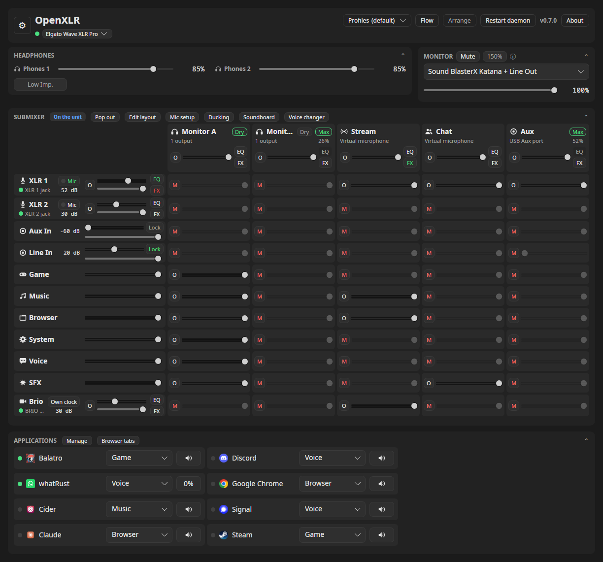

[](https://github.com/emaspa/openxlr/releases)
[](https://aur.archlinux.org/packages/openxlr)
[](https://copr.fedorainfracloud.org/coprs/emaspa/openxlr/)
[](https://launchpad.net/~sparvoli/+archive/ubuntu/openxlr)
[](https://github.com/emaspa/openxlr/releases/latest)
[](packaging/yabridge/README.md)

[](https://discord.gg/4bswtnGPW4)
[](https://www.reddit.com/r/OpenXLR/)
[](https://buymeacoffee.com/emaspa)
[](https://ko-fi.com/emaspa)
[](https://github.com/sponsors/emaspa)

OpenXLR is a Wave Link replacement for Linux. Its mixer runs on PipeWire
and works with any microphone or audio interface PipeWire can record
from: per-application channels, virtual microphones for calls and
streams, monitor mixes on any output, ducking, a microphone EQ, LV2, CLAP
and VST3 plugin inserts, and an OpenDeck plugin for Stream Deck control.
On Elgato hardware it also drives the device itself over
reverse-engineered USB protocols: gain, mute, phantom power, the onboard
effects and EQ, the headphone outputs and, on the Wave XLR Pro, output
routing, a second-computer mix on the USB Aux port, ducking on the
unit's own processor and, as an experiment, mixes built in the unit.




The UI from 0.7.0 and the terminal mixer from 0.2.0, both in the Broadcast
skin. This README and the linked guides describe current `main`; for a
released build, read the docs at its release tag. Not affiliated with or
endorsed by Elgato. The device protocols come from Wave Link USB captures,
prior open-source protocol work and tests on the author's own hardware.

## Supported devices

Any capture source PipeWire lists works in the mixer. Bound to XLR 1 or
XLR 2 ([manual](docs/manual.md#input-bindings)) it gets that strip's
sends, volume, meter, EQ, insert chain and Mic setup; its preamp gain and
phantom power stay on the device itself.

These Elgato devices also get their hardware controls over USB:

| Device | USB id | Status |
|---|---|---|
| Wave XLR Pro | 0fd9:00b4 | controls and the EQ on the unit verified on hardware; ducking on the unit accepted by ear on the headphone jacks and the USB Aux port; hardware mixing (experimental) heard on one unit |
| XLR Dock (Stream Deck+ module) | 0fd9:00a6 | gain, mute, headphone volume, 48V phantom power, low impedance; verified |
| Wave XLR | 0fd9:007d | gain, mute, headphone volume, low impedance and phantom power verified by community testers |
| Wave XLR MK.2 | 0fd9:00b6 | gain, mute, phantom power, low impedance, DSP, ClipGuard, compressor, headphone volume, crossfade, verified by a community tester; the EQ on the unit from firmware 1.0.15, verified |
| XLR Dock MK.2 (Stream Deck+ module) | 0fd9:00c7 | the Wave XLR MK.2's controls, verified |
| Wave:3 | 0fd9:0070 | gain, mute, ClipGuard, headphone volume and the monitor balance, each written and read back on the maintainer's unit; gain, mute, the monitor balance and the desktop volume controls verified there |
| Wave:3 MK.2 | 0fd9:00ca | gain, mute, headphone volume, crossfade, the EQ on the unit, low cut, compressor and voice tune verified on the maintainer's unit; the compressor and expander settings on the unit written and read back there; ClipGuard mapped from the Wave XLR MK.2 |
| Wave:1 | 0fd9:006e | the Wave:3's controls; gain, mute and headphone volume confirmed by an owner |

[Hardware support](docs/hardware-support.md) has every control's state,
including what is coded but not yet run on hardware. If you own an
untested device, open an issue with a diagnostics archive
([Community and issues](#community-and-issues)).

## Features

- **Hardware control** of the devices above, down to the Pro's per-input
  effects, both headphone outputs and the routing of HP1, HP2, Line Out
  and USB Aux. Low cut and ClipGuard run in software where the hardware
  has none.
- **Hardware mixing** on the Wave XLR Pro (experimental): each channel
  streams to the unit on a USB pair of its own and the unit builds the
  mixes its jacks and USB Aux port play, so the microphones reach the
  headphones with no delay and ducking runs per channel in the unit
  ([manual](docs/manual.md#hardware-mixing)).
- **Submixer** built from PipeWire nodes, no kernel modules: channels for
  the XLR inputs, Aux In, application groups and any other capture
  source, monitor mixes on any outputs, virtual microphones other apps
  record from. You change all of it while audio plays.
- **Ducking**: a key microphone lowers chosen channels in chosen mixes
  while you speak, in software everywhere and on the Pro's own processor
  when the setup fits, with presets or your own sensitivity, amount and
  speed.
- **Microphone processing**: an EQ of up to sixteen bands with Wave
  Link's band types (up to four on the unit where it has an EQ), EQ
  profiles saved by name and loaded from the UI or a Deck key, a
  compressor and an expander with their own windows (on the unit's
  processor where it has them), and Mic setup, which loops a recorded take
  through the EQ and plugins while you tune them.
- **Noise removal** first in each microphone's chain, RNNoise or
  DeepFilterNet 3, built into every package.
- **Soundboard**: short clips played into the SFX channel from pads in
  the UI, each with its own gain, press mode and loop, and Stop all.
  Eighteen CC0 starter sounds come with it.
- **Voice changer** on any microphone: a robot, a radio, monsters, or your
  own pitch and formant, from its own window or a Deck key.
- **Plugin inserts**: LV2, CLAP and VST3 chains on each microphone input
  and each mix, with native editors, generated controls and bypass. The
  native host measures the delay each plugin adds on its audio, and a
  plugin too slow for a small block size can run on its own block.
  Windows VST3 and CLAP plugins run through `openxlr-yabridge`. Its host
  reports the system disk's model and serial number the way Windows does,
  so plugins that tie their licence to a machine ID, such as
  [Elgato Voice Focus](https://marketplace.elgato.com/product/voice-focus-cadb20d0-18f1-45da-bf59-0f898f1e1767),
  can activate.
- **Application routing** by name rules, Electron and Wine/Proton apps
  included; an optional Chromium companion routes single browser tabs
  ([browser routing](docs/browser-routing.md)).
- **Profiles**: named scenes of hardware settings and the whole submix,
  recalled from the UI, the API, a Stream Deck key or on connect.
- **Daemon and APIs**: the daemon owns the device and the graph and keeps
  running with the UI closed; WebSocket and HTTP APIs on a private Unix
  socket authenticated by peer credentials.
- **Terminal mixer** `openxlr-tui` ([manual](docs/manual.md#terminal)),
  an **Omarchy bar** plugin ([omarchy.md](docs/omarchy.md)), seventeen
  **skins** as data ([skins.md](docs/skins.md)) and seven **languages**
  ([localization](docs/localization.md)).

Every control, area by area: [docs/features.md](docs/features.md).

### OpenDeck plugin

Keys and dials for every switch, mute, level, insert, output and profile.
Dials get a touch panel with a knob, a level meter, the value and a mute
overlay; one dial can hold several targets.


Keys show an icon and a status lamp: red for a mute, green for an engaged
feature or the active monitor output.


## Install

After installing, follow [Getting started](docs/getting-started.md) to
connect a microphone, choose a listening output and route your first app.
The graphical mixer also opens a welcome guide on a clean first launch.

Packages exist for Arch Linux, CachyOS and Omarchy (AUR), Ubuntu (PPA),
Fedora (COPR) and NixOS (flake). Every release also carries a `.deb` and
an `.rpm`, with SHA-256 checksums and a build provenance attestation
(`gh attestation verify <file> --owner emaspa`).

**Arch Linux, CachyOS and Omarchy**, from the
[AUR](https://aur.archlinux.org/packages/openxlr):

```sh
yay -S openxlr        # or: paru -S openxlr
systemctl --user enable --now openxlr-daemon
openxlr               # the mixer UI, also in your application menu
```

On Omarchy, run `openxlr-omarchy-enable` once for the bar plugin.

**Ubuntu** 24.04 and 26.04, from the
[PPA](https://launchpad.net/~sparvoli/+archive/ubuntu/openxlr):

```sh
sudo add-apt-repository ppa:sparvoli/openxlr
sudo apt install openxlr
systemctl --user enable --now openxlr-daemon
openxlr
```

**Fedora** 44 or newer, from
[COPR](https://copr.fedorainfracloud.org/coprs/emaspa/openxlr/):

```sh
sudo dnf copr enable emaspa/openxlr
sudo dnf install openxlr
systemctl --user enable --now openxlr-daemon
openxlr
```

Without the PPA or COPR, install the `.deb` or `.rpm` from the
[latest release](https://github.com/emaspa/openxlr/releases/latest) with
`sudo apt install ./openxlr_*_amd64.deb` or
`sudo dnf install ./openxlr-*.x86_64.rpm`.

**NixOS**: add `inputs.openxlr.url = "github:emaspa/openxlr";` to your
system flake, then these entries to its `nixosSystem.modules` list:

```nix
openxlr.nixosModules.default
{ services.openxlr.enable = true; }
```

The [module options](packaging/nix/module.nix) cover LV2 plugins, software
ClipGuard and the Windows bridge.

**After installing**, replug an Elgato device once so the udev rule
applies, and log out and back in, or run
`systemctl --user restart wireplumber`, so the packaged WirePlumber rules
load. For the Stream Deck, install `com.emaspa.openxlr.sdPlugin.zip`
from the release with OpenDeck's install-from-file. Inserts list the LV2,
CLAP and VST3 plugins you have installed (`lsp-plugins-lv2` is a good
start); the software ClipGuard needs `swh-plugins`; Windows plugins need
`openxlr-yabridge` from the same place you got OpenXLR
([manual](docs/manual.md#windows-plugins)).

**Upgrading**: reboot, or run `systemctl --user restart openxlr-daemon`
and reopen the UI. When the release says a WirePlumber rule was added or
changed, run `systemctl --user restart wireplumber` before the daemon;
replug the interface only when it says the udev rule changed.

**From source**: [the source guide](docs/install-from-source.md) lists the
prerequisites, then:

```sh
git clone https://github.com/emaspa/openxlr.git
cd openxlr
dotnet restore src/OpenXLR.slnx --locked-mode
dotnet build src/OpenXLR.slnx -c Release --no-restore -warnaserror -p:EnableNativeLv2Host=true
OPENXLR_BUILD_MIXER=1 ./src/OpenXLR.Daemon/bin/Release/net10.0/OpenXLR.Daemon
./src/OpenXLR.UI/bin/Release/net10.0/OpenXLR.UI   # in a second terminal
```

**SteamOS and Bazzite**: each release carries an experimental Flatpak,
with steps for Desktop Mode and Game Mode in [flatpak.md](docs/flatpak.md).
OpenXLR will not be published on Flathub, whose rules do not allow
AI-assisted development.

## Limitations

- Another brand's microphone or interface gets the mixer, not its
  hardware controls.
- On the Pro, the unit's ducking runs only on the headphone jacks and the
  USB Aux port, and only keyed by XLR 1; other setups duck in software.
  Hardware mixing has room for eight channels beside the unit's own
  inputs, builds only the mixes the unit plays, and takes no plugin on
  those mixes. The mix maximizer and the channel booster are not
  available yet.
- Routing the focused application needs a compositor the UI can ask which
  window has focus: KWin, Hyprland, Sway, Niri, X11 through `xprop`, or
  GNOME Shell with the optional OpenXLR Focus extension
  ([gnome-focus.md](docs/gnome-focus.md)). Other Wayland compositors have
  no focus source yet.
- Windows plugins depend on Wine and yabridge. An editor that misbehaves
  there can be swapped for OpenXLR's generated controls.

The [roadmap](docs/roadmap.md) has what comes next, starting with user
reports and hardware checks of the 0.2 features.

## Documentation

The [documentation index](docs/README.md) lists every guide. The main
ones: the [manual](docs/manual.md), [features](docs/features.md),
[hardware support](docs/hardware-support.md), the
[WebSocket API](docs/api.md) and [HTTP API](docs/http-api.md),
[skins](docs/skins.md), the [architecture](docs/architecture.md) and the
[Wave XLR Pro protocol](docs/wave-xlr-pro-protocol.md).

## Community and issues

Support, hardware reports and release news are on
[Discord](https://discord.gg/4bswtnGPW4),
[r/OpenXLR](https://www.reddit.com/r/OpenXLR/) and GitHub issues. To
report one, open Options, SUPPORT, Collect diagnostics: it writes
`~/openxlr-diagnostics-<timestamp>.tar.gz` with the device state, the
PipeWire graph, logs and configs. Nothing is uploaded; attach it yourself.
To contribute, read [CONTRIBUTING.md](CONTRIBUTING.md).

## Status

Developed and used daily by the author with a Wave XLR Pro, an XLR Dock,
an XLR Dock MK.2, a Wave:3, a Wave:3 MK.2 and a Stream Deck + XL; community testers
verified the Wave XLR and Wave XLR MK.2. Tests against a private PipeWire
server cover setups without Elgato hardware. The two maintainers write
the code, with AI tooling (Anthropic's Claude and OpenAI's Codex)
assisting with capture analysis, UI design and parts of the coding; the
person who opens a pull request is its author and answers for every line
of it ([AGENTS.md](AGENTS.md)). Every hardware finding was verified on a
real device.

## License

[GPL-3.0](LICENSE). The native plugin host carries third-party code under
its own licences, each kept beside it: the CLAP headers in `native/clap`
and the VST3 interface headers in `native/vst3` (MIT), Signalsmith Stretch
1.4.0 and the Signalsmith Linear headers it builds on in `native/signalsmith`
(MIT), RNNoise 0.2 in `native/rnnoise` (BSD-3-Clause), libDF from DeepFilterNet 0.5.6 in
`native/deepfilter/libdf` with the DeepFilterNet3 model it embeds (MIT or
Apache-2.0), and the Rust crates DeepFilterNet builds on, listed in
`native/deepfilter/Cargo.lock`, each under its own package's licence (MIT,
Apache-2.0 or a choice including one of them, Unicode-DFS-2016 beside
those for one crate, CC0-1.0 for tiny-keccak).

If you find OpenXLR useful, consider
[buying me a coffee](https://buymeacoffee.com/emaspa) or supporting it on
[Ko-fi](https://ko-fi.com/emaspa).
